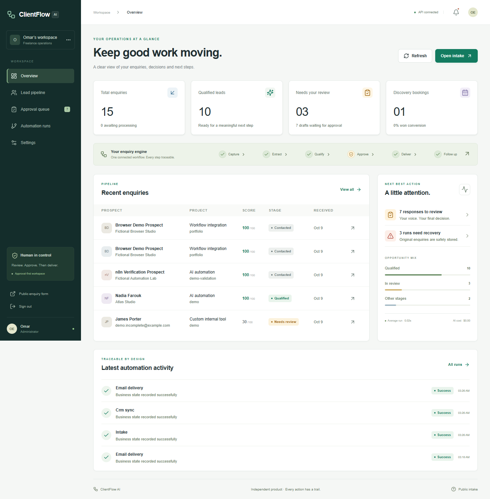
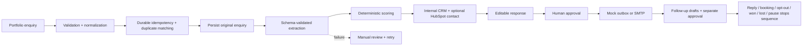
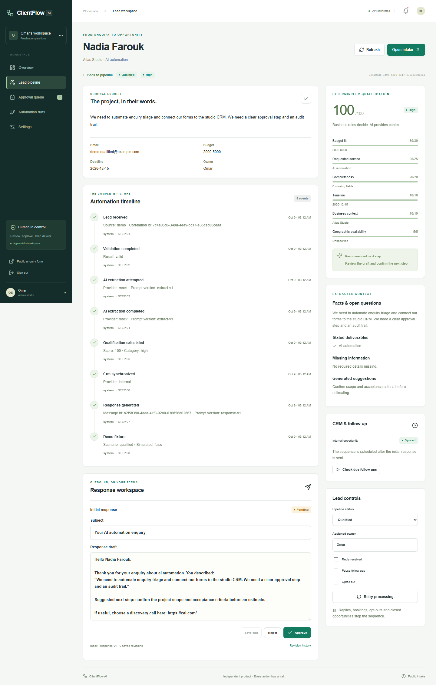
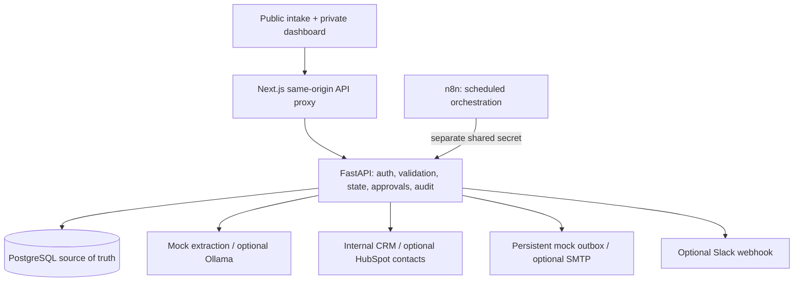

# ClientFlow AI

[](https://github.com/omarelweeshy/clientflow-ai/actions/workflows/ci.yml)
[](LICENSE)

**Next.js · TypeScript · FastAPI · PostgreSQL · n8n · Docker**

**From an unstructured enquiry to an actionable opportunity, with a human in control.**

ClientFlow AI captures portfolio enquiries, extracts requirements, applies transparent qualification rules, maintains an internal CRM opportunity and prepares responses for approval. Its operations dashboard shows the complete history and lets an administrator edit, approve, deliver and recover failed work.

ClientFlow AI is an independent portfolio and internal-operations project inspired by recurring requirements in real freelance automation briefs. It is not presented as commissioned client work.

**Evaluation status:** working local demo with fictional data, deterministic mock extraction and a persistent mock email outbox. Optional live providers are implemented but unverified. No paid API key is needed to evaluate it.

Start with the [five-minute reviewer guide](docs/REVIEWER_GUIDE.md), [engineering case study](docs/CASE_STUDY.md) or [verification evidence](docs/VERIFICATION.md).

The [Vercel portfolio edition](docs/VERCEL.md) runs an isolated browser simulation with fictional data. The Docker edition below runs the real backend, database and n8n workflows. Public mode never connects to the private workspace or sends external messages.



## Run the complete local demo

Requires Docker Desktop with Linux containers, Docker Compose and Python 3.12+ for the one-time standard-library configuration script. No external account or model download is needed.

```powershell
git clone https://github.com/omarelweeshy/clientflow-ai.git
cd clientflow-ai
.\scripts\start-demo.ps1
```

Linux/macOS:

```sh
git clone https://github.com/omarelweeshy/clientflow-ai.git
cd clientflow-ai
sh scripts/start-demo.sh
```

The startup script generates configuration when missing, starts the stack, seeds fictional data, imports and publishes all five n8n schedules. On Linux/macOS use `sh scripts/start-demo.sh`. The configuration script preserves an existing `.env`. The administrator password is generated in `local-secrets/admin-password.txt`. Both paths are ignored by Git. Read the password locally, then sign in at [localhost:3010/login](http://localhost:3010/login).

- Dashboard: [localhost:3010/dashboard](http://localhost:3010/dashboard)
- Portfolio intake: [localhost:3010/intake](http://localhost:3010/intake)
- API reference: [localhost:8010/docs](http://localhost:8010/docs)
- n8n editor: [localhost:5678](http://localhost:5678)

Default ports 3010 and 8010 avoid common local project conflicts. Set `WEB_PORT`, `API_PORT` and the matching `PUBLIC_ORIGIN` to change them.

The stack runs database migration `0001` before starting FastAPI. Named volumes preserve the database and n8n configuration. Seeding is repeatable and does not duplicate fixtures. `docker compose down` stops services without removing data.

## Business workflow



The automation is the product. The dashboard is the control surface. The **lead detail timeline** connects original requirements, scoring, CRM state, draft revisions, delivery and follow-ups in one inspectable history.



## Architecture



See [architecture decision](docs/ADR-001.md), [data model and API](docs/API.md), [security model](docs/SECURITY.md), [n8n workflows](docs/N8N.md) and [verification report](docs/VERIFICATION.md).

### Why AI and business rules are separate

AI produces a schema-validated summary, deliverables, missing information, urgency and explicitly labelled suggestions. It cannot run tools, approve messages, choose scores or alter consent. Unknown budget, deadline and business context are independently flagged by code even if a model omits them.

The demonstration mock returns the original enquiry as its summary and the chosen service as a deliverable. It is intentionally deterministic, not a claim of real semantic AI quality. Real Ollama extraction uses the same schema and routes provider/schema failures to review. Response generation uses a conservative personalized template based on submitted facts and deterministic next-step rules, not unrestricted model-written outreach. It makes no claims about price, experience or availability.

Editable weights cover budget, service, completeness, timeline, business context and geography. Spam penalties, low-budget caps, thresholds, probable-duplicate checks and urgent-review conditions are configurable in the dashboard. Defaults are demonstrations, not universal sales policy. Changes apply to future processing; previous breakdowns remain recorded.

### Durable deduplication

An intake key stores the normalized payload hash and resulting lead. Reusing a key with a different payload returns HTTP 409. A unique fingerprint of normalized email, enquiry and requested service prevents exact duplicate leads across different keys. Same email with a different enquiry is a new opportunity flagged for review; configurable probable matching also uses normalized phone and matching company/website.

One internal opportunity per lead, one message per sequence step, one mock delivery per message and one follow-up per position are enforced by database constraints. PostgreSQL row locks serialize lead processing, approvals and delivery. Public receipts do not disclose another prospect's lead ID or duplicate status.

### Approval and recovery

Approval applies to a specific saved draft. Editing preserves the old revision and resets approval. Delivery checks approval, opt-out and sequence-stop conditions again. Separate follow-ups need separate approval and the final follow-up waits for first-follow-up delivery.

AI failure preserves the original intake. CRM failures leave the internal opportunity recoverable. Integration exceptions are replaced with safe errors. A manual retry creates a new run and marks earlier failures resolved when it succeeds. Mock deliveries are transactionally idempotent. SMTP cannot guarantee exactly-once delivery; a timeout or crash is treated as uncertain and blocked for reconciliation, with no blind resend.

The optional safe-automation switch is disabled by default. Explicitly enabling it permits automatic **initial** responses for complete, high-category, consented leads only. Follow-ups always require approval. Keep it off while evaluating the product.

## n8n

Five credential-free exports are included in `n8n/`: intake, CRM, approved-email delivery, follow-up scheduling/stop checks and failure notification. Both manual and scheduled triggers call protected backend operations. Error outputs retain execution context for review.

The startup script enables scheduled follow-up checks and approved delivery in the local n8n instance. Plain `docker compose up` without the startup script requires the import/publish steps below. The default `ORCHESTRATION_MODE=app` processes intake immediately, so the demo works even before workflow import. Use `ORCHESTRATION_MODE=n8n`, import and publish the workflows to let n8n process stored pending intake. See [exact import, execution and publishing commands](docs/N8N.md).

## Fictional demonstration data

Twelve leads cover strong fit, incomplete requirements, duplicate redelivery, spam, low budget, urgency, AI failure, CRM failure, email failure, reply, booking and opt-out. Failure fixtures explicitly record `simulated: true`; retrying uses the real mock adapter pipeline. Seeded replies/bookings/opt-outs show cancelled follow-up sequences.

## Verification and tests

Backend tests use a disposable database whose name must contain `test`. Never point them at the demo database.

```powershell
python -m venv .venv
.\.venv\Scripts\python.exe -m pip install -r backend\requirements.txt
cd backend
..\.venv\Scripts\python.exe -m pytest -q
..\.venv\Scripts\ruff.exe check .
cd ..
python scripts/check_exports.py
cd frontend
npm ci --no-audit --no-fund
npm run lint
npm run typecheck
npm test
npm run build
```

The backend suite also supports PostgreSQL via `DATABASE_URL`; CI provisions `clientflow_test`. Frontend unit tests verify composed pipeline filters. Browser smoke checks cover actual form submission, dashboard navigation, lead timeline, approval, delivery, retry views and mobile overflow. See [verification evidence and limitations](docs/VERIFICATION.md).

## Optional real integrations

Edit `.env`, then recreate the API using `docker compose up -d --force-recreate api`.

| Integration | Configuration | Scope |
|---|---|---|
| Ollama | `LLM_PROVIDER=ollama`, `OLLAMA_URL`, `OLLAMA_MODEL` | Structured extraction from a separately running local Ollama server |
| HubSpot | `CRM_PROVIDER=hubspot`, `HUBSPOT_TOKEN` | Contact upsert by email; internal CRM owns opportunities |
| SMTP | `EMAIL_PROVIDER=smtp`, host, port, sender, username, password | STARTTLS email after approval; uncertain delivery requires reconciliation |
| Slack | `SLACK_WEBHOOK_URL` + enable notifications in settings | Lead ID and score only; no enquiry/email in notifications |
| Booking | Set your HTTPS Cal.com or other booking URL in settings | Discovery link in appropriate drafts; booking is recorded manually |

Adapters follow the [Ollama structured-output schema API](https://docs.ollama.com/capabilities/structured-outputs) and [HubSpot contact API](https://developers.hubspot.com/docs/api-reference/legacy/crm/objects/contacts/guide). Implementation does not establish live verification. No OpenAI, SendGrid, calendar OAuth or inbound mailbox adapter is included in this MVP. See the verification report for which paths were exercised.

## Security and production limits

Local ports bind only to loopback. Administration uses a signed HTTP-only session, a password hash and session-bound CSRF tokens. Public intake cannot invoke administrator or automation endpoints. Secrets stay in the environment; logs exclude raw provider errors and the automation ledger stores IDs rather than enquiry payloads.

This is a usable single-organization MVP, **not a fully hardened production deployment**. Before accepting public enquiries: configure HTTPS, secure cookies, a real booking URL, reliable email, gateway rate limiting, backups, retention/deletion policy, dependency monitoring, monitoring/alerts, worker isolation and provider reconciliation. n8n is a trusted administrator surface with environment access enabled for these local workflows. Never expose its editor publicly without hardened access controls. See [threat model and limitations](docs/SECURITY.md).

## Troubleshooting

| Problem | Action |
|---|---|
| API unhealthy | `docker compose logs --tail 100 api`; check database health and migration |
| Cannot sign in | Read the generated local password; verify the configured `PUBLIC_ORIGIN` matches the browser URL |
| CSRF failure | Sign in again; open `localhost`, not an alternate host or IP |
| Intake stuck at NEW | If using n8n mode, import/publish intake and check its protected API call |
| AI/CRM/email failed | Inspect the lead and automation ledger; fix provider configuration, then retry |
| SMTP uncertain/sending | Check provider delivery logs; do not reset and resend blindly |
| No due follow-ups | Initial response must be sent, lead eligible, scheduled time reached and prior step delivered |
| Port occupied | Change host mapping and matching `PUBLIC_ORIGIN`; keep internal API URL `http://api:8000` |
| Repeated setup | Existing `.env` is intentionally preserved; configuration script does not rotate active secrets |

## Roadmap

1. Queue worker with durable leases, bounded automatic retries and dead-letter handling.
2. Live-provider contract tests, delivery reconciliation and automated inbound replies/booking webhooks.
3. Per-person administrator accounts, session revocation, retention/export/deletion, backups and restore drills.
4. Verified portfolio embedding and production infrastructure with TLS and ingress abuse protection.

MIT licensed. No multi-tenant billing, campaigns, voice agent or workflow builder is included.
