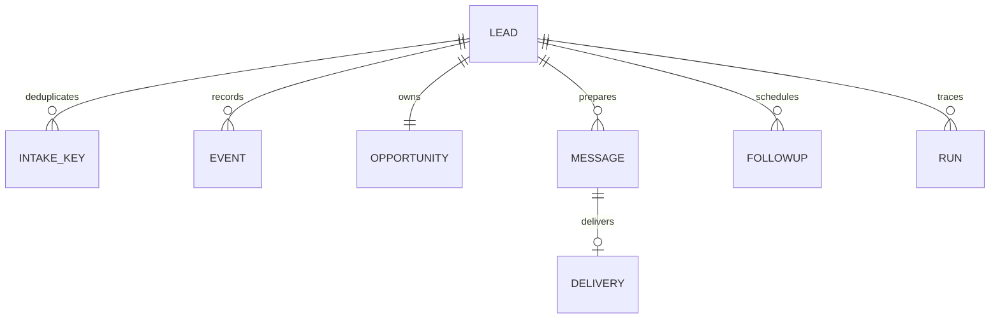

# API and data model

Interactive OpenAPI: `http://localhost:8010/docs`; JSON schema: `/openapi.json`.

The frontend proxies only `/public`, `/auth`, `/admin` and `/health` to a fixed API host. It never proxies the automation namespace or forwards bearer credentials supplied by a browser. It forwards a client address only when `TRUST_UPSTREAM_FORWARDED_FOR=true` declares that a sanitising ingress sits in front of it; otherwise it sends none and the API falls back to the socket peer. See [security model](SECURITY.md).

Every response carries `X-Correlation-ID`, matching the identifier on each structured log line for that request. The proxy passes it through, so a reported problem can be traced in the API logs without guessing.

| Boundary | Endpoint | Purpose |
|---|---|---|
| Public | `POST /public/intake` | Strict intake; `Idempotency-Key` required, optional UUID `X-Correlation-ID` |
| Public | `GET /public/config` | Service and budget options |
| Public | `GET`, `POST /public/opt-out` | Signed expiring link; explicit POST confirmation stops future delivery |
| Auth | `POST /auth/login` | Password verification, origin check, HTTP-only cookie |
| Admin | `GET /auth/session`, `POST /auth/logout` | Session CSRF token / logout |
| Admin | `GET /admin/overview` | Metrics derived from persisted state |
| Admin | `GET /admin/leads`, `GET /admin/leads/{id}` | Pipeline and complete context/history |
| Admin | `PATCH /admin/leads/{id}` | Status, owner, reply, pause and opt-out |
| Admin | `POST /admin/leads/{id}/retry` | Retry an unprocessed enquiry |
| Admin | `GET /admin/messages` | Pending approval queue |
| Admin | `GET /admin/messages/unresolved` | Deliveries whose outcome is unknown and need reconciliation |
| Admin | `POST /admin/messages/{id}/reconcile` | Record the operator's finding: `delivered` or `not_delivered` |
| Admin | `PATCH /admin/messages/{id}` | Save a revision and reset approval |
| Admin | `POST /admin/messages/{id}/approve`, `/reject`, `/send` | Explicit approval and guarded delivery |
| Admin | `GET /admin/runs`, `POST /admin/runs/{id}/retry` | Sanitized ledger and recovery |
| Admin | `GET`, `PUT /admin/settings` | Rules, thresholds, timing and provider configuration names |
| Admin | `GET /admin/audit` | Append-only record of sensitive administrative actions |
| Admin | `POST /admin/followups/tick` | Prepare due drafts, applying stop and ordering checks |
| Automation | `GET /automation/pending` | Pending IDs, no enquiry body |
| Automation | `POST /automation/leads/{id}/process` | Idempotent process operation |
| Automation | `POST /automation/crm/tick` | Pending opportunity synchronization |
| Automation | `POST /automation/email/tick` | Approved eligible draft delivery |
| Automation | `POST /automation/followups/tick` | Due sequence stop checks and draft preparation |
| Automation | `GET /automation/failures`, `POST /automation/failures/notify` | Safe errors and configured notification |
| Automation | `POST /automation/maintenance/tick` | Ages stuck send intents into reconciliation; prunes expired rate buckets |
| Health | `GET /health` | Liveness only; no database access |
| Health | `GET /health/ready` | Readiness, including a database check |

Administrator mutations require the session cookie, exact configured `Origin` and `X-CSRF-Token` from `/auth/session`. Automation requires `Authorization: Bearer <AUTOMATION_SECRET>`. Public intake is public by design, with durable rate counters and a honeypot; the private automation API uses a shared secret. It is not a signed public intake webhook.

Intake success returns a uniform receipt and correlation ID. Validation: 422. Conflicting key: 409. Rate limit: 429. Authentication: 401. Origin/CSRF: 403. Unknown IDs: 404. Integration business failures are stored and visible in the lead/run state; HTTP 200 on an operation does not mean an external provider succeeded.

Events are append-only through the application API. Draft revisions are retained in the message record. Runs contain workflow, trigger, correlation ID, attempts, timestamps, safe IDs, output status, error category and retry state. Qualification explanations are stored as rule breakdowns and review reasons, with missing information separate from generated suggestions. Lead outcomes, replies and bookings are administrator-recorded in this MVP.

Audit history for settings is stored separately from leads. The application exposes no event-update/delete endpoint. Database administrators are trusted and can edit data; database-level tamper-proof auditing is a production requirement.
