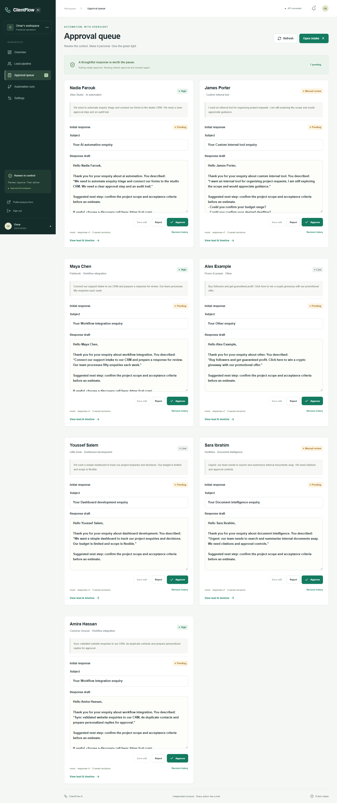
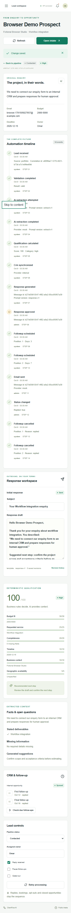

# ClientFlow AI: from enquiry to approved action

## Problem

Freelance enquiries arrive with inconsistent requirements, budgets and timelines. A response generator alone leaves the operator to qualify each request, maintain CRM state, avoid duplicate outreach, approve changes and stop follow-ups when someone replies.

ClientFlow AI brings those steps into one inspectable workflow for a single organization. The operator sees the original request beside extraction, qualification, draft revisions and delivery history.

## Implementation

The Next.js dashboard provides the review surface. FastAPI validates input and owns decisions, state transitions and authorization. PostgreSQL enforces uniqueness and serializes competing actions. n8n calls protected backend operations on schedules without becoming a second source of business state.

Extraction is a bounded provider interface. The demo uses a deterministic mock; optional Ollama output must satisfy the same schema. Budget, consent, scoring, approval and sequence-stop decisions stay in code. Responses use conservative templates grounded in submitted facts.

## Decisions and tradeoffs

| Decision | Benefit | Cost or limit |
|---|---|---|
| Keep business state in PostgreSQL/FastAPI | Consistent behavior across dashboard and scheduler | Backend code is required to extend the workflow |
| Separate extraction from qualification rules | Scores remain explainable and model text cannot authorize outreach | Rules need business calibration |
| Approval tied to saved draft revisions | An edit cannot reuse approval for older text | An extra operator step |
| Durable keys, unique constraints and row locks | Retries and competing requests do not duplicate mock delivery | PostgreSQL is required for concurrency guarantees |
| Record uncertain SMTP delivery | Prevents unsafe blind retries after ambiguous failure | External reconciliation remains manual |
| Default to mocks and fictional fixtures | Reviewers can reproduce the workflow without credentials | Does not demonstrate live-provider reliability |

## Evidence

The recorded implementation verification includes 35 PostgreSQL backend tests, three frontend tests, production builds, desktop/mobile browser workflow checks and five live local n8n workflows. These are engineering checks, not customer or revenue outcomes. See [the full report](VERIFICATION.md) for exact scope and limitations.

## Next work

A production pilot needs a durable worker queue, verified providers, inbound reply/booking events, per-user authentication, retention/deletion, TLS ingress, backups and monitoring. The present scope is a reproducible single-organization portfolio MVP. No client deployment, time-saving percentage or sales uplift is claimed.
