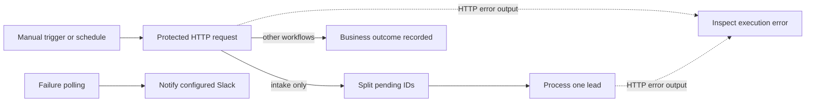

# n8n workflow operations

The local stack includes n8n. Exported JSON contains environment expressions, no credentials or secret literals. n8n's editor is a trusted administrator surface: environment access is deliberately enabled for the shared-secret expression. Never enable untrusted workflow editing.

Successful executions retain ID-only request/output context for inspection. HTTP error outputs terminate in a Stop And Error node with a fixed sanitized message, making the execution visibly failed. Business-level failures returned with HTTP 200 remain recorded in the backend automation ledger. The workflows contain no Python code nodes; n8n's optional Python-runner warning in this image does not affect these workflows. External runner isolation remains production work.

Create the local n8n owner through its editor when you want interactive access. CLI import/execution can validate the workflows without an external n8n account. Per the [n8n Server CLI documentation](https://docs.n8n.io/deploy/host-n8n/configure-n8n/use-the-command-line.md), import and publication change the local database; restart n8n after CLI publication changes.

```powershell
docker compose exec n8n n8n import:workflow --separate --input=/workflows
docker compose exec -e N8N_RUNNERS_BROKER_PORT=5681 n8n n8n execute --id=clientflow01
docker compose exec -e N8N_RUNNERS_BROKER_PORT=5681 n8n n8n execute --id=clientflow02
docker compose exec -e N8N_RUNNERS_BROKER_PORT=5681 n8n n8n execute --id=clientflow03
docker compose exec -e N8N_RUNNERS_BROKER_PORT=5681 n8n n8n execute --id=clientflow04
docker compose exec -e N8N_RUNNERS_BROKER_PORT=5681 n8n n8n execute --id=clientflow05
```

Exports are initially unpublished. The start-demo scripts import and publish all five schedules. CLI execution uses a separate broker port because the running editor uses 5679. For scheduled operation, set `ORCHESTRATION_MODE=n8n` in `.env`, recreate the API, then publish the five imported workflows:

```powershell
docker compose up -d --force-recreate api
docker compose exec n8n n8n publish:workflow --id=clientflow01
docker compose exec n8n n8n publish:workflow --id=clientflow02
docker compose exec n8n n8n publish:workflow --id=clientflow03
docker compose exec n8n n8n publish:workflow --id=clientflow04
docker compose exec n8n n8n publish:workflow --id=clientflow05
docker compose restart n8n
```



| Workflow | Schedule | Backend guarantees |
|---|---|---|
| Intake | 1 minute | Stored pending intake, schema validation, scoring, original data preservation |
| CRM | 5 minutes | One internal opportunity; optional contact upsert |
| Email | 1 minute | Approved draft only, send-time consent/stop checks, durable deduplication |
| Follow-ups | 15 minutes | Stop checks, ordering, separate approval for each draft |
| Failure notification | 5 minutes | Safe error records; optional Slack disabled by default |

The app processes CRM sync as part of intake. The separate CRM workflow drains pending opportunities; failed runs require an operator retry rather than unbounded automatic attempts. The email workflow delivers already approved drafts. It does not approve them. The follow-up workflow prepares drafts; it does not send unapproved outreach. Notification workflow is a no-op with notifications disabled.

To exercise a non-empty intake workflow, use n8n orchestration mode and submit `examples/intake.json` with a new intake key. Run the intake workflow and verify a lead timeline with `trigger=n8n`. For email, approve a draft, execute workflow 03, execute it again and verify only one delivery and two follow-ups. The end-to-end verification report separates successful CLI execution from scheduled/UI verification and real external-provider delivery.
