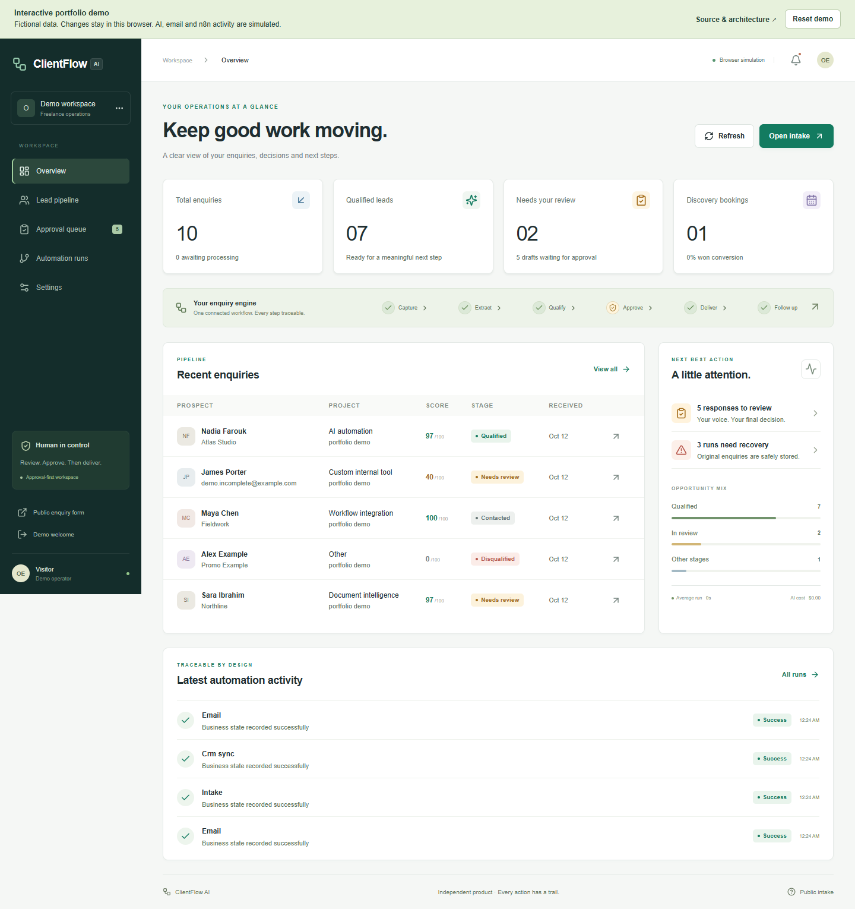

# Public portfolio demo on Vercel

**Live demo:** <https://clientflow-ai-eight.vercel.app> · Public access verified without login on 2026-10-12.

The Vercel edition is an interactive browser simulation. It demonstrates the interface and workflow with ten fictional sample leads. It has no connection to the private FastAPI service, PostgreSQL database, n8n editor or provider credentials.

## Deployment settings

- Git repository: `omarelweeshy/clientflow-ai`
- Root directory: `frontend`
- Framework: Next.js; Node.js 24
- Install: `npm ci --no-audit --no-fund`
- Build: `npm run build`
- Environment: `NEXT_PUBLIC_DEMO_MODE=true` in production, preview and development
- No backend URL, database password, administrator password, automation secret or provider token is needed or should be added.

The flag must be present **during the build**. Next.js embeds public environment variables into client assets. Redeploy after changing it. The project is intentionally configured for the public demo, not live enquiry collection.

## Behavior and limits

Visitors can inspect sample leads, submit fictional enquiries, edit and approve drafts, simulate delivery, check due follow-ups, record replies and retry simulated failures. Revisions reset approval; repeated delivery does not create another simulated delivery; stop conditions cancel future steps.

Changes are saved to this origin's browser local storage. They are separate for each browser profile and shared across tabs in that profile. They are not private encrypted storage: use fictional data only. A persistent banner explains the simulation and offers a reset with confirmation. Clearing site storage also removes changes. The demo supports at most 100 leads before a reset is required.

No request from the demo interface calls the server API. The Next.js API proxy returns HTTP 403 for all routes in demo mode. Simulated timestamps, scores and histories are illustrative, not evidence of live AI generation or n8n execution. Automatic responses and Slack notifications remain disabled. No email, booking or CRM update is sent externally.

## Verification

`frontend/tests/demo.test.mjs` covers isolated state, intake idempotency, revision approval, duplicate delivery, follow-up ordering, cancellation, failure recovery and unsupported-route rejection. `scripts/public-demo-smoke.cjs` checks the production UI on desktop/mobile, refresh persistence, separate browser contexts, reset, absence of UI API calls and HTTP 403 for server endpoints. GitHub Actions builds both the default Docker-compatible frontend and the public mode, then runs browser checks.

On 2026-10-12, all nine frontend tests, lint/type checking, production builds and all three [GitHub Actions jobs](https://github.com/omarelweeshy/clientflow-ai/actions/runs/38176032539) passed for implementation commit `6b7687c`. The same browser smoke passed against the live production URL without Vercel authentication. Desktop/mobile screenshots were inspected. The Docker backend has not been moved to Vercel.



To preview locally from `frontend`:

```powershell
$env:NEXT_PUBLIC_DEMO_MODE='true'
npm run build
npm run start -- --hostname 127.0.0.1 --port 3011
```

In a second terminal at the repository root:

```powershell
$env:BROWSER_CHANNEL='msedge' # Or install Chromium with npx playwright install chromium
node scripts/public-demo-smoke.cjs
```

To check the deployed URL, set `CLIENTFLOW_URL` to its HTTPS origin before running the same smoke script. Test in a new browser context, with no Vercel authentication, to establish that visitors can access it directly.

## Full application

The Docker edition remains the implementation with real FastAPI/PostgreSQL persistence and scheduled n8n workflows. Its default remains `NEXT_PUBLIC_DEMO_MODE` unset. Deploying that edition for real users additionally requires hosted services, TLS, production authentication, ingress abuse protection, backups, retention controls and verified providers. See [the threat model](SECURITY.md).

Deployment references: [Vercel monorepos](https://vercel.com/docs/monorepos) and [environment variables](https://vercel.com/docs/environment-variables).
